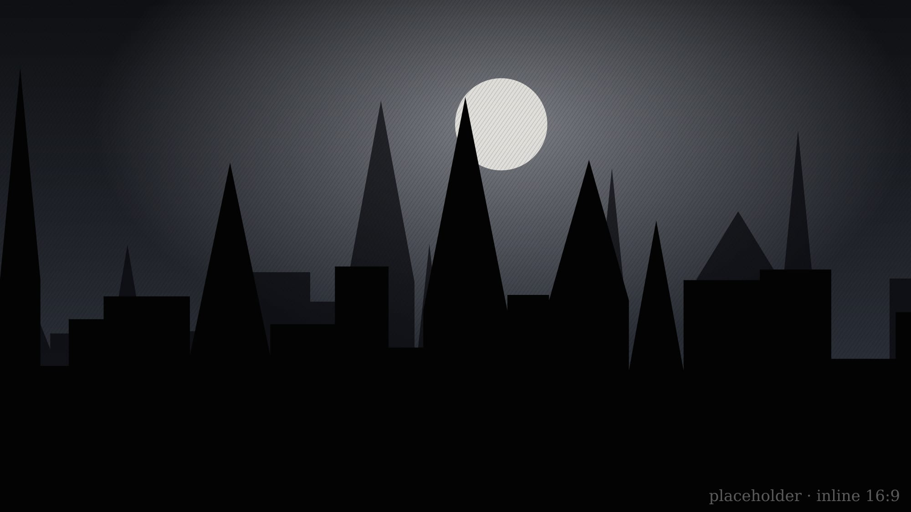
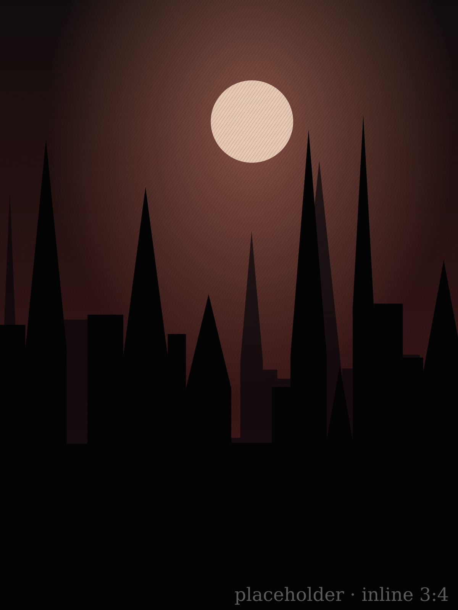

There is a particular discomfort that arrives around the third minute of a shot that will not cut. The eye has finished its inventory of the frame. The mind begins to ask what it is supposed to be feeling, and the film, quietly, refuses to say.

Most of what we watch is built to spare us that moment. Editing is a kind of mercy: it decides for us when we have seen enough. The long take withdraws the mercy, and in its absence we are left alone with time, which is to say, alone with ourselves.[^bazin]

Grief works the same way. It does not cut away when we have understood it. It holds on the empty room long after the room has told us everything it has to tell, and it waits to see whether we will stay.

> “Editing is a kind of mercy. The long take withdraws it.”

## The third minute

I want to argue that this is not a failure of pacing but a form of instruction. The film is teaching a posture: *attention without the promise of payoff*. It is the same posture asked of anyone keeping vigil.

Consider what the shot actually contains. There are, broadly, three things it asks of us:

- that we stop waiting for the cut;
- that we notice the small changes, the drift of light, a figure shifting its weight;
- that we accept the shot may end without having *meant* anything at all.

None of these is difficult in itself. What is difficult is doing them **for nine minutes**, in a room full of strangers, with no permission to look away. Critics have written about this at length; the [Criterion essays](https://www.criterion.com/) are a good place to start.

***

## Remaining

The cinema of slowness is often described as difficult, and it is, in the way that sitting with a friend in hospital is difficult. Nothing is being withheld from you. You are simply being asked to remain.[^vigil]

And perhaps that is the gift. Not an answer, not a catharsis, but practice: a rehearsal, in a dark room, for the long takes that life will eventually insist on.

[^bazin]: Bazin wrote of the long take as a respect for the continuity of reality. The point here is narrower: it respects the continuity of the viewer.

[^vigil]: A vigil, in the old sense, is simply a watch kept through the night. Nothing is required of the watcher except that they do not leave.
